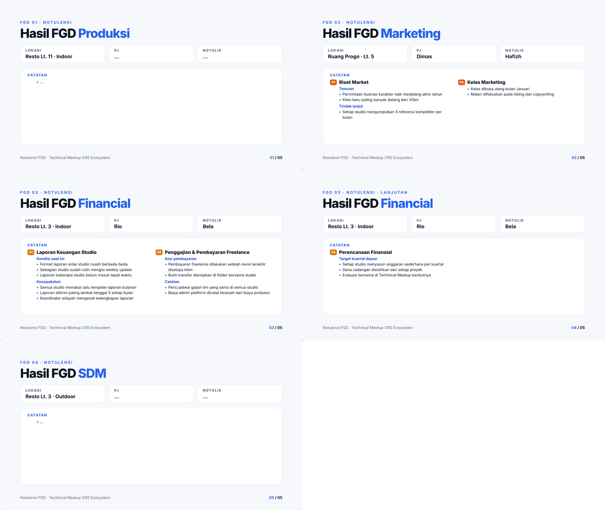

# crs-notulis-fgd

Plugin untuk membuat **slide notulensi FGD** 16:9 dengan branding CRS Ecosystem, dengan warna yang sama seperti deck informasi umum.



## Isi

- Skill `template-notulis-fgd`: satu slide notulensi per kelompok FGD (Produksi, Marketing, Financial, SDM), berisi lokasi, PJ, notulis, dan kotak Catatan.
- Catatan disusun bertingkat **Heading → Sub-heading → Poin**, otomatis dibagi ke 2 kolom atau slide lanjutan bila panjang.
- **Cek diksi negatif**: `scripts/cek_diksi.py` menandai kata seperti *gagal, telat, buruk, masalah*. Claude menawarkan opsi yang lebih positif dan meminta konfirmasi dulu. Tidak ada kata yang diganti tanpa persetujuan.

## Pasang plugin

**Claude (aplikasi desktop / claude.ai):** buka **Customize → Plugins → Add marketplace**, masukkan `benediktussatrio111-create/crs-notulis-fgd`, lalu klik **Install** pada plugin `crs-notulis-fgd`. Nyalakan **Sync automatically** agar selalu mendapat versi terbaru.

**Claude Code:**

```
/plugin install crs-notulis-fgd --marketplace benediktussatrio111-create/crs-notulis-fgd
```

atau dua langkah: `/plugin marketplace add benediktussatrio111-create/crs-notulis-fgd` lalu `/plugin install crs-notulis-fgd@crs-ecosystem-notulis`.

## Cara pakai

Minta Claude: "buatkan template notulis FGD", "template notulensi kosongan untuk Technical Meetup", atau kirim catatan mentah dan minta "rapikan jadi notulensi FGD".

Manual:

```bash
cd skills/template-notulis-fgd
python3 scripts/cek_diksi.py examples/notulensi-contoh-isi.json
python3 scripts/build_deck.py examples/notulensi-kosong.json notulensi.html
```

## Struktur

```
.claude-plugin/plugin.json
skills/template-notulis-fgd/
  SKILL.md
  scripts/{build_deck.py, cek_diksi.py}
  references/{deck.css, tokens.json, diksi.json}
  examples/{notulensi-kosong.json, notulensi-contoh-isi.json}
```
